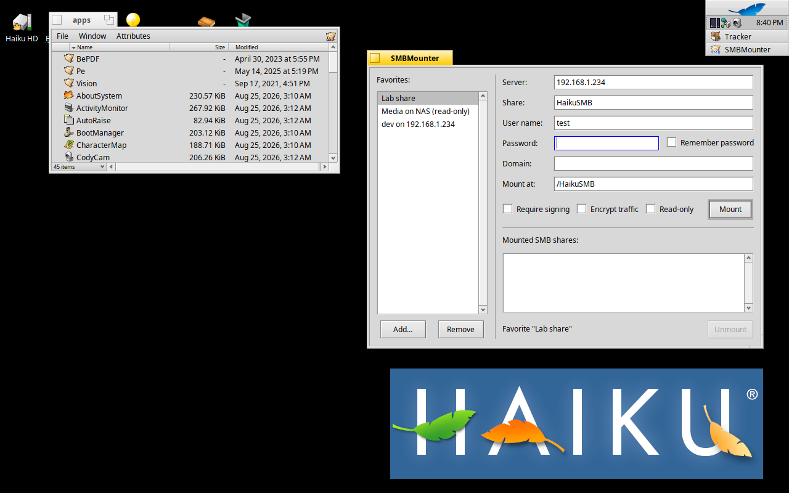
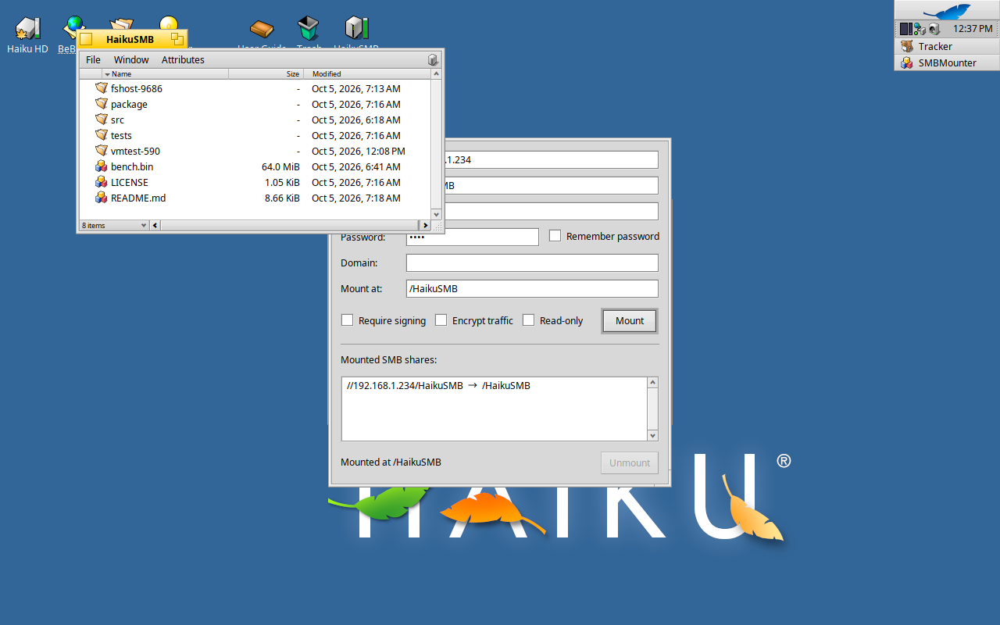

# HaikuSMB — native SMB2/SMB3 client for Haiku

HaikuSMB lets Haiku mount SMB network shares exported by Windows, Samba
(Linux, BSD, NAS devices) and other SMB2/SMB3 servers. Mounted shares appear
in Tracker like any other volume and can be used from the Terminal.

It consists of three parts, all packaged together as `smbfs`:

| Component    | Where it lives                          | Purpose |
|--------------|-----------------------------------------|---------|
| `smbfs`      | `add-ons/kernel/file_systems/smbfs`     | Kernel file system add-on implementing the SMB2/SMB3 client protocol |
| `mount_smbfs`| `bin/mount_smbfs`                       | Command line tool to mount shares |
| `SMBMounter` | `apps/SMBMounter` (also in Tracker's add-ons menu and the Deskbar) | Native GUI to mount and unmount shares |

There is no FUSE or userland file system layer involved: `smbfs` is a regular
Haiku kernel file system add-on, like `nfs4`, `bfs` or `ext2`, written in
C++ under the MIT license.

## Features

- SMB dialects 2.0.2, 2.1, 3.0, 3.0.2 and 3.1.1 (negotiated automatically).
- NTLMv2 authentication (with MIC), guest/anonymous sessions.
- Message signing: HMAC-SHA256 (SMB 2.x) and AES-128-CMAC (SMB 3.x), with
  SMB 3.1.1 pre-authentication integrity. Signing is used whenever the
  server requires it, for all SMB 3.1.1 sessions, or when requested.
- Encryption: AES-128-GCM and AES-128-CCM (SMB 3.x), used when the server or
  share requires it or when requested with the `seal` option.
- Compounded requests for path operations (one network round trip for stat,
  delete, rename, mkdir, ...), large reads and writes (up to 1 MiB per
  request with multi-credit support).
- Transparent reconnection: if the connection to the server drops, the
  session is re-established and open files are reopened on the next access.
- Attribute caching with a short timeout (2 seconds by default) to keep
  Tracker responsive.
- Node monitor notifications for changes made through the mount, so Tracker
  windows update immediately.
- Works with case-insensitive servers; Unicode file names are supported.

## Installing

Build the package on a Haiku system with the `haiku_devel` package installed
(see "Building" below), then:

```
pkgman install smbfs-1.0.0-5-x86_64.hpkg
```

The same package works on Haiku R1/beta6 and on nightly builds: the kernel
add-on only uses kernel symbols that both release and debug (nightly) kernels
export. If `mount` reports "No such device", the kernel could not load the
add-on; `/var/log/syslog` then names the missing symbol.

Alternatively, for development, copy the kernel add-on to
`/boot/system/non-packaged/add-ons/kernel/file_systems/smbfs`
(`make -C src/kernel install` does this).

## Mounting from the Terminal

The simplest way is `mount_smbfs`:

```
mount_smbfs -u test //192.168.1.234/HaikuSMB
```

It asks for the password (unless given with `-p`), creates the mount point
(`/HaikuSMB` by default, or the directory given as second argument) and
mounts the share. Like Haiku's own disk mounter, the default mount point is
`/<share name>`, with a number appended if that name is already taken (a
share called `dev` is mounted at `/dev1`, never over `/dev`). Mount points
must be empty directories; system directories are refused. Use
`unmount /HaikuSMB` to unmount it again. Run
`mount_smbfs --help` for all options (`-r` read-only, `-s` require signing,
`-e` require encryption, `-d domain`, `-o "extra options"`).

The standard `mount` command works too; all settings are passed with `-p`:

```
mkdir /HaikuSMB
mount -t smbfs -p "//192.168.1.234/HaikuSMB user=test password=test" /HaikuSMB
```

### Mount options

Options are separated by spaces. Values containing spaces can be quoted.

| Option             | Meaning |
|--------------------|---------|
| `//server/share`   | The share to mount (first word; `\\server\share` also works). Alternatively `server=` and `share=`. |
| `user=NAME`        | User name. Leave out for an anonymous/guest session. |
| `password=SECRET`  | Password. |
| `domain=DOMAIN`    | Domain or workgroup (optional). |
| `port=N`           | TCP port (default 445). |
| `sign`             | Require message signing. |
| `seal`             | Require encryption (needs SMB 3.x on the server). |
| `ro`               | Mount read-only (`mount -ro` does the same). |
| `vers=X`           | Highest dialect to use: `2.0.2`, `2.1`, `3.0`, `3.0.2` or `3.1.1` (default). `mindialect=X` sets the lowest. |
| `uid=N`, `gid=N`   | Owner shown for all files (defaults to the mounting user). |
| `exec`             | Show files as executable (`rwxr-xr-x`), e.g. to run programs from the share. By default files are `rw-r--r--` and directories `rwxr-xr-x`. |
| `fmask=OCT`, `dmask=OCT` | Permission bits to remove from files/directories. `file_mode=`/`dir_mode=` set the modes directly (e.g. `file_mode=0755`). |
| `cache=SECONDS`    | Attribute cache timeout (default 2; 0 disables caching). |
| `timeout=SECONDS`  | Network request timeout (default 30). |
| `trace`            | Log protocol details to the syslog. |

SMB servers do not store POSIX permissions; files are shown with the modes
given by `file_mode`/`dir_mode`, and the read-only attribute of a file is
mapped to the write bits (`chmod a-w file` sets the attribute, `chmod u+w`
clears it). Files are deliberately not shown as executable unless the `exec`
option is given: Haiku treats executable files as programs, and copies from
the share keep their permissions.

Every file with a known extension carries a virtual, read-only `BEOS:TYPE`
attribute with its MIME type (`catattr BEOS:TYPE movie.mp4` prints
`video/mp4`). This gives Tracker the right icons and applications without
reading file contents over the network, and it works on read-only shares.
Other attributes cannot be stored on SMB shares (yet).

## Mounting from Tracker

`SMBMounter` is installed in `/boot/system/apps`, in the Deskbar
"Applications" menu, and in Tracker's "Add-ons" menu (right-click in any
Tracker window). Enter the server, share, user name and password, and press
"Mount". The share is mounted at `/<share name>` (editable) and opened in a
Tracker window. Mounted shares are listed at the bottom of the window and can
be unmounted from there (or with Tracker's usual "Unmount" command).

"Remember password" stores the password in Haiku's key store
(`keystore_server`), so it does not have to be typed again (the key store
asks once whether SMBMounter may access the keyring).

The "Favorites" panel on the left keeps saved connections. Fill in the form
and press "Add" to save it under a name; clicking a favorite fills the form
again (the password comes from the key store if it was remembered), and
double-clicking mounts it right away. Right-click a favorite to mount, rename
or remove it; "Remove" or the Delete key remove the selected one. Favorites
are kept in the settings file (`~/config/settings/SMBMounter settings`), never
with a password.





The fields can also be prefilled from the command line, and the Mount and
Unmount buttons can be triggered with Haiku's `hey` scripting tool:

```
SMBMounter //192.168.1.234/HaikuSMB user=test mountpoint=/HaikuSMB
hey SMBMounter 'mnt '     # press Mount
hey SMBMounter 'umnt'     # press Unmount (selected or only share)
```

## Building

Everything builds natively on Haiku with the `haiku_devel` package:

```
make -C src/kernel          # kernel add-on -> src/kernel/objects/smbfs
make -C src/mount_smbfs     # command line tool
make -C src/SMBMounter      # GUI
package/build-package.sh    # all of the above, then creates the .hpkg
```

The kernel add-on is compiled with the flags Haiku uses for kernel add-ons
(`-D_KERNEL_MODE -ffreestanding -fpic -mno-red-zone ...`) and linked against
`/boot/system/develop/lib/_KERNEL_`.

### Tests

- `src/tools/smbtest` — userland test client for the protocol core. Builds
  on Haiku and Linux. `smbtest selftest` runs a self-test against a share
  (`--local-root` cross-checks written files against the local directory the
  share exports; `--sign`, `--seal`, `--max-dialect` select protocol
  variants). It also offers `ls`, `cat`, `put`, `get`, `mkdir`, `rm`, `mv`,
  `df`, `bench` for ad-hoc testing.
- `src/tools/crypto_test` — unit tests for the cryptographic primitives
  against published test vectors.
- `src/tools/fshost` — runs the kernel add-on's actual Volume/Inode/VFS-hook
  code as a userland program on Linux (with a small emulation of the parts of
  Haiku's VFS it uses). It exercises lookups, directory listings, renames,
  vnode eviction, changes made by a second client, reconnection and unmount,
  and is meant to be run under AddressSanitizer or valgrind:
  `make -C src/tools/fshost && src/tools/fshost/objects/fshost "//server/share user=... password=..."`.
- `src/tools/kdl_autoreboot` — a kernel debugger add-on for unattended test
  machines: after a kernel panic it types `bt` and `reboot` at the KDL
  prompt, so the machine comes back on its own and the panic plus stack trace
  can be read from `/var/log/previous_syslog`. Install with
  `make -C src/tools/kdl_autoreboot install` (into
  `~/config/non-packaged/add-ons/kernel/debugger`) and reboot; remove the
  file to get the interactive debugger back.
- `tests/launchcheck.cpp` — small probe that performs the calls Tracker makes
  when a document is double-clicked (type lookup, `FindApp`, forced MIME
  update) and prints the results for a file on a mounted share.
- `testdata/` — a few tiny sample files (a generated MP4/MKV, a text file)
  used by the probes above.
- `tests/vm-test.sh` — end-to-end test on a Haiku system using ordinary
  shell commands on a mounted share (copying, comparing, renaming, parallel
  readers and writers, executing a binary from the share, unmounting):
  `tests/vm-test.sh //server/share user password [extra mount options]`.

## Design notes

The full architecture and design description (protocol core, kernel add-on,
caching model, POSIX mapping, testing, lessons learned) is in
[docs/HaikuSMB.md](docs/HaikuSMB.md). The short version:

- `src/smb2/` is the portable protocol core (transport framing, negotiate,
  session setup, tree connect, signing, encryption, compounding, file
  operations). It has no Haiku kernel dependencies beyond a small platform
  layer (`Platform.cpp`: locks, time, randomness, logging), so the same code
  runs in the kernel, in Haiku userland and on Linux for testing.
- `src/smb2/Crypto.cpp` contains self-contained implementations of MD4, MD5,
  SHA-256, SHA-512, HMAC, AES-128, AES-CMAC, AES-CCM, AES-GCM, RC4 and the
  SP800-108 KDF, verified against published test vectors.
- `src/kernel/` is the Haiku-specific part: `Volume` (mount options, inode
  table, lookup cache), `Inode` (attribute cache, open handles, directory
  enumeration) and `kernel_interface.cpp` (the `fs_vnode_ops` /
  `fs_volume_ops` tables).
- Unmounting: the kernel removes a mount from its tables and calls the file
  system's `unmount()` hook before it sends the unmount notification, but it
  frees the root vnode (and releases the file system module) only afterwards.
  Tracker reacts to the notification by closing its windows, and while doing
  so it opens the folder again by entry_ref, which can still reach the old
  root vnode. If the add-on had already been unloaded this crashed the kernel
  in `vnode_path_to_vnode()`; the stale root vnode can even outlive the mount
  structure, so hooks may be called with a NULL or dangling `fs_volume`.
  smbfs therefore keeps its module loaded (`B_KEEP_LOADED`), validates the
  `fs_volume` and vnode pointers it is given against a registry of live
  mounts before touching them, and keeps unmounted volumes (a few KiB each)
  as inert "zombies" so that pointer identities stay unique. Hooks on an
  unmounted volume fail cleanly with "entry not found". (This looks like a
  VFS issue worth reporting upstream.)
- The page writer skips pages that are already being written when a file
  cache is synced, so a few writes can still be in flight when a file is
  closed. The size reported by the server is therefore never allowed to
  shrink the local file size while we have written to the file recently.
- Tracker and `cp -p` set a copied file's permissions and times while it is
  still open and its data may still be in Haiku's file cache. Before changing
  permissions or times, smbfs therefore writes the cached data, applies the
  change through the open handle, and lets later write-back use that handle
  instead of opening the file again (a server refuses to open a read-only
  file for writing). Write-back failures are logged and returned by `fsync()`
  and `close()`. Versions before 1.0.0-5 lost the data of copied read-only
  files and did not keep the times of copied files.
- SMB has no persistent file identifiers that a client can rely on, so inode
  numbers are assigned by the add-on and kept stable for the lifetime of a
  mount. Each inode knows its parent and name; paths are rebuilt on demand,
  which keeps renames of directories cheap.
- Requests are processed synchronously, one at a time per connection, which
  keeps the kernel part simple and robust. Reads and writes go through
  Haiku's file cache; the cache fetches and flushes data through
  `read_pages()`/`write_pages()` in requests of up to 1 MiB. File cache
  operations are only ever issued from VFS hooks, never from inside those
  page callbacks and never while holding the add-on's locks.

## Limitations and future work

- No network browsing (listing servers/shares) and no printer support.
- No Kerberos authentication (NTLMv2 only).
- Symbolic links, hard links, writable Haiku attributes (they could be mapped
  to alternate data streams), file locking and change notifications from the
  server are not supported yet. Only the virtual `BEOS:TYPE` attribute is
  provided.
- File data is cached through Haiku's file cache (which also makes `mmap`
  and running programs from a share possible). Cached data is dropped when
  a file's size or modification time changes on the server, which is checked
  whenever attributes are refreshed; there are no server-side change
  notifications (leases) yet, so changes made by other clients become
  visible after the attribute cache timeout.
- Only one session and tree connect per mount; multiple mounts to the same
  server use separate connections.
- The mount password is passed as a mount parameter and could be seen by
  other local users; Haiku is single-user, so this is acceptable for now.

## Authors

- John Rash
- Claude Opus 5.5

## License

MIT, see `LICENSE`.
