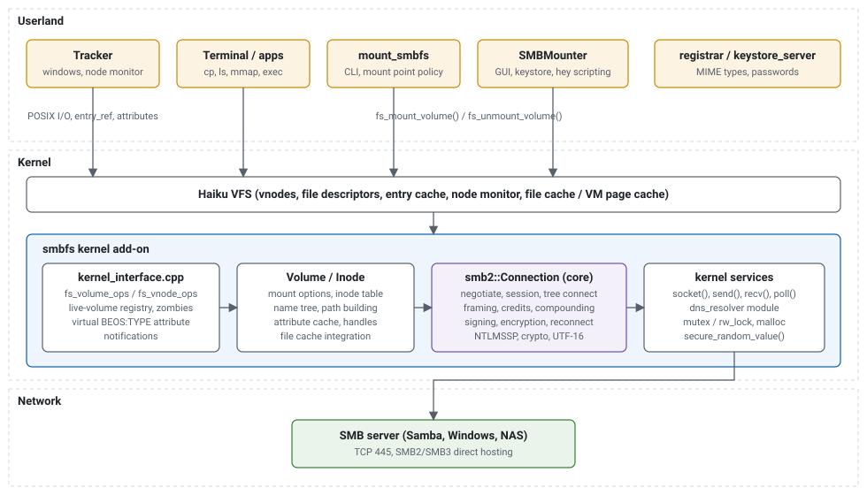
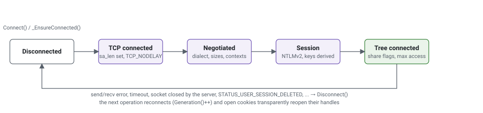
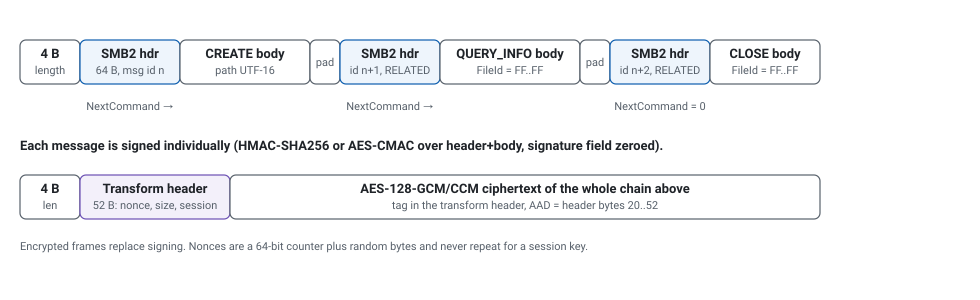
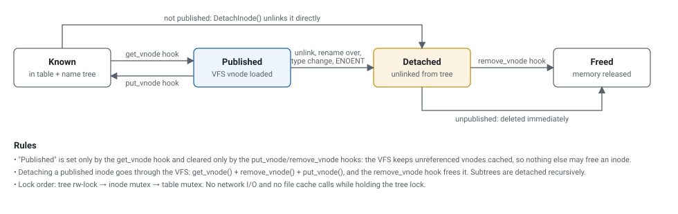
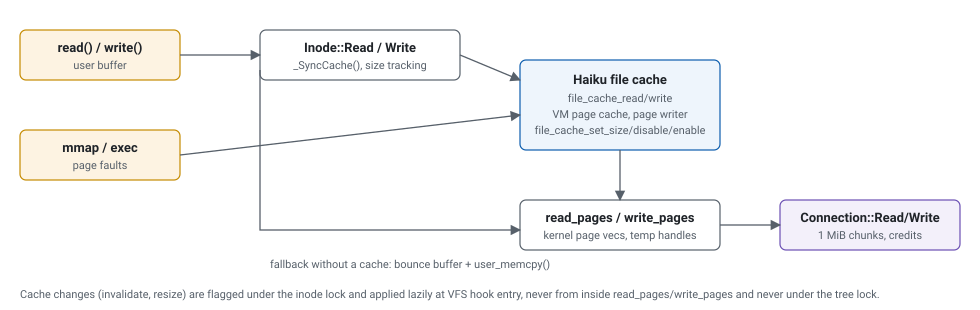

# HaikuSMB — Architecture and Design

*A native SMB2/SMB3 client file system for Haiku: kernel add-on, command line mounter and graphical mounter. Version 1.0.0, tested on Haiku R1/beta6 (hrev59866, x86_64) against Samba 4.*

## Contents

1. [Overview and goals](#1-overview-and-goals)
2. [Repository layout](#2-repository-layout)
3. [Architecture](#3-architecture)
4. [The protocol core (src/smb2)](#4-the-protocol-core-srcsmb2)
5. [The kernel add-on (src/kernel)](#5-the-kernel-add-on-srckernel)
6. [POSIX to SMB mapping](#6-posix-to-smb-mapping)
7. [Caching and consistency](#7-caching-and-consistency)
8. [mount_smbfs and SMBMounter](#8-mount_smbfs-and-smbmounter)
9. [Packaging and installation](#9-packaging-and-installation)
10. [Mount options reference](#10-mount-options-reference)
11. [Security](#11-security)
12. [Testing and tooling](#12-testing-and-tooling)
13. [Haiku kernel lessons learned](#13-haiku-kernel-lessons-learned)
14. [Limitations and future work](#14-limitations-and-future-work)
15. [Building from source](#15-building-from-source)

## 1. Overview and goals

HaikuSMB lets Haiku mount SMB network shares exported by Windows, Samba (Linux, BSD, NAS appliances) and other SMB2/SMB3 servers. A mounted share behaves like any other volume: it appears on the Desktop and in Tracker, and it can be used from the Terminal with ordinary commands. The project consists of three parts that are delivered together as the `smbfs` package:

| Component | Installed at | Role |
|---|---|---|
| `smbfs` *(kernel)* | `/boot/system/add-ons/kernel/file_systems/smbfs` | Kernel file system add-on implementing the SMB2/SMB3 client protocol and Haiku's file system interface. |
| `mount_smbfs` *(userland)* | `/boot/system/bin/mount_smbfs` | Command line tool: resolves `//server/share`, asks for a password, picks a safe mount point, calls `fs_mount_volume()`. |
| `SMBMounter` *(userland)* | `/boot/system/apps/SMBMounter`, Tracker add-ons menu, Deskbar | Native GUI to mount and unmount shares, with favorites, key-store password storage and `hey` scripting. |

### Design goals

- **Native.** The file system is a regular Haiku kernel add-on like `nfs4`, `bfs` or `ext2`. There is no FUSE or userland file system layer and no dependency on Samba's or libsmb2's code, so the result can be packaged, installed and (potentially) upstreamed like any other Haiku file system. The code is MIT licensed.
- **Modern protocol.** SMB 2.0.2 through 3.1.1 with NTLMv2 authentication, message signing, encryption and compounding, so it works with current Windows releases (which require signing by default) and with hardened Samba servers.
- **Feels like Haiku.** Correct MIME types in Tracker, node-monitor notifications for changes made through the mount, a GUI that opens the share in a Tracker window, Tracker add-on and Deskbar integration, mount points chosen the way Haiku's own disk mounter chooses them, and an `.hpkg` package.
- **Testable outside the kernel.** The protocol core and even the kernel add-on's own logic can be built and exercised as userland programs on Linux, under AddressSanitizer and valgrind, against a real server. Kernel crashes are expensive on a test VM, so everything that can be tested elsewhere is.

### Non-goals for version 1

Network browsing (listing servers and shares), printing, Kerberos, DFS, server-side change notifications, symbolic links, writable Haiku attributes and file locking are out of scope for the first version; see [section 14](#14-limitations-and-future-work).

### Why not Samba or libsmb2?

A Haiku file system that is not a FUSE/userlandfs hack has to live in the kernel, and the kernel cannot link userland libraries. Samba's `libsmbclient` is a large userland library with its own event loop and GPL licensing; `libsmb2` is smaller but also userland oriented, event-loop based and LGPL. Writing a focused SMB2 client in C++ against the published MS-SMB2/MS-FSCC/MS-NLMP specifications turned out to be the cleanest path: the core is about 5,400 lines, it uses Haiku's kernel conventions directly (locks, sockets, logging, memory), and it is MIT licensed. Samba was used throughout as the reference *server* for testing.

## 2. Repository layout

```
HaikuSMB/
├── README.md, LICENSE, .gitignore
├── docs/                      this document, its figures and screenshots
├── package/
│   ├── PackageInfo            .hpkg metadata (name, version, provides/requires)
│   └── build-package.sh       builds everything on Haiku and creates
│                              smbfs-1.0.0-5-x86_64.hpkg here (not in git)
├── src/
│   ├── smb2/                  portable SMB2/SMB3 client core (kernel and userland)
│   │   ├── Types.h            basic types / Haiku error codes (with non-Haiku fallbacks)
│   │   ├── Platform.{h,cpp}   locks, time, randomness, logging (kernel vs. userland)
│   │   ├── Buffer.h           little-endian packet builder and bounds-checked reader
│   │   ├── Utf.{h,cpp}        UTF-8 <-> UTF-16LE
│   │   ├── Smb2Defs.h         protocol constants (commands, flags, info classes, NTSTATUS)
│   │   ├── NtStatus.{h,cpp}   NTSTATUS -> status_t mapping and names
│   │   ├── Crypto.{h,cpp}     MD4, MD5, SHA-256/512, HMAC, AES-128, CMAC, CCM, GCM, RC4, KDF
│   │   ├── Ntlm.{h,cpp}       NTLMSSP (NTLMv2 with MIC, key exchange)
│   │   └── Connection.{h,cpp} transport, negotiate, session, tree, signing, encryption,
│   │                          compounding, file operations
│   ├── kernel/                Haiku kernel add-on
│   │   ├── kernel_interface.cpp  fs_volume_ops / fs_vnode_ops hooks, module info
│   │   ├── Volume.{h,cpp}        mount options, inode table, lookup cache, paths
│   │   ├── Inode.{h,cpp}         attribute cache, open handles, file cache, directories
│   │   ├── MimeTypes.{h,cpp}     extension -> MIME type table (virtual BEOS:TYPE)
│   │   ├── include/              kernel_debug_config.h, tracing_config.h (missing from haiku_devel)
│   │   └── Makefile
│   ├── mount_smbfs/           command line mounter
│   ├── SMBMounter/            GUI mounter (BApplication), .rdef resources
│   └── tools/
│       ├── crypto_test.cpp    crypto unit tests (published test vectors)
│       ├── smbtest.cpp        userland protocol test client (ls, cat, put, selftest, bench...)
│       ├── fshost/            runs the kernel add-on's hooks as a Linux program (fake VFS)
│       └── kdl_autoreboot/    kernel debugger add-on: auto "bt" + "reboot" after a panic
├── tests/
│   ├── vm-test.sh             end-to-end shell test on a Haiku machine
│   ├── gui-test.sh            scripted SMBMounter favorites test (hey, waitfor)
│   ├── copyorder.cpp          copies a file in Tracker's call order (used by vm-test.sh)
│   └── launchcheck.cpp        probe that mimics Tracker's document launch calls
└── testdata/                  tiny sample files used by the probes
```

Code size: about 12,400 lines of C++ in total (not counting blank lines and comments), of which the protocol core is 5,400, the kernel add-on 3,000, the tools, harnesses and tests 2,400 and the two userland programs 1,500.

## 3. Architecture



*Figure 1: Layers. Applications talk to the Haiku VFS; the VFS calls the add-on's hooks; the hooks use the portable protocol core, which uses the kernel's socket API.*

The central design decision is the split between the **protocol core** (`src/smb2`), which knows nothing about Haiku's VFS, and the **kernel add-on** (`src/kernel`), which knows nothing about SMB packets. The core is written against a tiny platform layer (`Platform.h`: a mutex, an rw-lock, monotonic and wall-clock time, random bytes, logging) with two implementations selected by `_KERNEL_MODE`: Haiku kernel primitives, or pthreads/POSIX. Because Haiku exports the BSD socket API to kernel add-ons (`socket()`, `connect()`, `send()`, `recv()`, `poll()`, `setsockopt()`, `close()`), the transport code is identical in both environments. This is what makes it possible to run the same core on Linux and in Haiku userland for testing, and to run the kernel add-on's own hook code under a fake VFS on Linux (see [section 12](#12-testing-and-tooling)).

### Threading model

One mount owns one TCP connection, one SMB session and one tree connect (`smb2::Connection`). Requests are issued synchronously: the calling thread (whatever VFS hook is executing) takes the connection lock, sends the request, waits for the response(s) and releases the lock. There is no dedicated receiver thread and no asynchronous pipelining. This keeps the kernel part small and avoids an entire class of lifetime and wake-up bugs; the price is that concurrent operations on one mount are serialized at the network. Large transfers are still fast because each READ/WRITE moves up to 1 MiB, and the file cache serves repeated reads from memory. A receiver thread with pipelined requests is a natural future extension (the request/response matching by MessageId is already in place).

## 4. The protocol core (src/smb2)

### 4.1 Building blocks

| File | Purpose | Notes |
|---|---|---|
| `Types.h` | Fixed-width integer typedefs and Haiku error codes. | On Haiku it includes `SupportDefs.h`/`Errors.h`; elsewhere it defines the same values so the core returns real `status_t` codes everywhere. `SMB2_DISCONNECTED` (`ECONNRESET`) signals a lost transport. |
| `Platform.{h,cpp}` | `Mutex`, `RWLock` with RAII lockers, `SystemTime()`, `RealTimeUsecs()`, `RandomBytes()`, `Log()`/`Trace()`. | Kernel: `mutex`/`rw_lock`, `system_time()`, `real_time_clock_usecs()`, `secure_random_value()`, `dprintf()`. Userland: pthreads, `clock_gettime`, `/dev/urandom`, stderr. |
| `Buffer.h` | `Packet` (growable little-endian writer with `SetU32()` patching and 8-byte alignment) and `Reader` (bounds-checked parser). | All wire formats are built and parsed through these; no packed structs, so there are no alignment or endianness assumptions. |
| `Utf.{h,cpp}` | UTF-8 to UTF-16LE and back, with surrogate pairs. | SMB2 paths and names are UTF-16LE; Haiku uses UTF-8. |
| `Crypto.{h,cpp}` | Self-contained MD4, MD5, SHA-256, SHA-512, HMAC, AES-128 (T-table, S-box generated at init), AES-CMAC, AES-CCM, AES-GCM, RC4, SP800-108 KDF, constant-time compare. | Freestanding (only `memcpy`/`memset`). Verified against FIPS/NIST/RFC vectors, MS-NLMP 4.2.4 vectors and cross-checked with Python's `cryptography` (see [12.1](#12-testing-and-tooling)). |
| `Ntlm.{h,cpp}` | NTLMSSP client: NEGOTIATE, CHALLENGE parsing, AUTHENTICATE with NTLMv2 response, LMv2 or zeroed LM response, AV-pair handling (timestamp, MsvAvFlags with MIC, channel bindings, `cifs/host` target name), key exchange, MIC. | Raw NTLMSSP tokens are used in SESSION_SETUP (as Linux cifs does); Windows and Samba accept them without SPNEGO wrapping. Anonymous sessions send an empty user. |
| `Connection.{h,cpp}` | Everything else: connect, negotiate, session setup, tree connect, request building, framing, credits, compounding, signing, encryption, reconnection and the operations used by the file system. | About 2,400 lines; described below. |

### 4.2 Connection lifecycle



*Figure 2: Connection states. Every public operation starts with `_EnsureConnected()`, so a dropped connection is re-established transparently; the generation counter tells the kernel layer that server file handles are stale.*

#### Negotiate

The client offers the dialects allowed by the options (default 2.0.2 to 3.1.1) with capabilities `LARGE_MTU` and `ENCRYPTION`. For 3.1.1 it adds the mandatory `PREAUTH_INTEGRITY_CAPABILITIES` context (SHA-512, 32-byte salt) and an `ENCRYPTION_CAPABILITIES` context offering AES-128-GCM and AES-128-CCM. The response fixes the dialect, the server's security mode (signing required?), capabilities and the maximum read/write/transact sizes (clamped to 1 MiB reads/writes by default and to 64 KiB when multi-credit is unavailable). For 3.1.1 the negotiate request and response are hashed into the pre-authentication integrity value.

#### Session setup

Two round trips with NTLMSSP: NEGOTIATE in, CHALLENGE out (`STATUS_MORE_PROCESSING_REQUIRED`), AUTHENTICATE in, `STATUS_SUCCESS` out with the session flags (guest/null/encrypt). The session id comes from the first response header. The session key (NTLM exported session key, 16 bytes) feeds key derivation:

| Dialect | Signing | Encryption keys |
|---|---|---|
| 2.0.2, 2.1 | HMAC-SHA256(SessionKey), truncated to 16 bytes | not available |
| 3.0, 3.0.2 | AES-128-CMAC with KDF(SessionKey, "SMB2AESCMAC", "SmbSign") | KDF(SessionKey, "SMB2AESCCM", "ServerIn ") / ("ServerOut"), AES-128-CCM |
| 3.1.1 | AES-128-CMAC with KDF(SessionKey, "SMBSigningKey", PreauthHash) | KDF(SessionKey, "SMBC2SCipherKey"/"SMBS2CCipherKey", PreauthHash), negotiated cipher (GCM preferred) |

Signing is enabled when the server requires it, when the `sign` option is given, or always for 3.1.1 sessions (the dialect's own rule). The final session setup response is verified with the derived key, which protects against downgrade of the negotiation. Encryption is enabled when the session or the share demands it (`SMB2_SESSION_FLAG_ENCRYPT_DATA`, `SMB2_SHAREFLAG_ENCRYPT_DATA`) or when the `seal` option is given; it requires SMB 3.x and a session key. Guest or anonymous sessions have no key: they cannot sign, and mounting fails if signing is required.

#### Tree connect

`\\server\share` is connected; the tree id, share type (only disk shares are accepted), share flags and the maximal access mask are recorded. If the mask lacks `FILE_WRITE_DATA`, the mount is marked read-only.

### 4.3 Requests, framing, credits and compounding



*Figure 3: A compounded request (path info query = CREATE + QUERY_INFO + CLOSE) as sent on the wire, and the encrypted form.*

- **Transport framing.** Direct TCP hosting on port 445: a 4-byte big-endian length prefix (24 bits) followed by one or more SMB2 messages. Reception uses `poll()` with the request timeout (default 30 s) and a persistent, growing receive buffer; additional frames in one call (interim or split responses) get their own allocations and are kept until the next call so response pointers stay valid.
- **Credits.** The client tracks granted credits; each request requests enough to keep 64 in hand (capped at 256), and charges `ceil(payload / 64 KiB)` for READ, WRITE, QUERY_DIRECTORY and QUERY_INFO when the server supports large MTUs. MessageIds advance by the charge. Reads and writes are chunked to what the credits and size limits allow.
- **Compounding.** Related chains use the `0xFFFF…` FileId placeholder and `SMB2_FLAGS_RELATED_OPERATIONS`; the responses are matched to the requests by MessageId whether they arrive in one frame or several. Path operations are all single round trips: stat (CREATE+QUERY_INFO FileAllInformation+CLOSE), delete (CREATE+SET_INFO disposition+CLOSE), rename (CREATE+SET_INFO rename+CLOSE), mkdir (CREATE+CLOSE), set size/times/attributes (CREATE+SET_INFO+CLOSE), file system info (CREATE+QUERY_INFO size+QUERY_INFO attributes+CLOSE).
- **Interim responses.** `STATUS_PENDING` with the async flag is skipped; the final response completes the request. Unsigned responses are rejected once signing is active (except session setup); signed responses are verified.
- **Status mapping.** `NtStatusToError()` maps NTSTATUS to Haiku codes (e.g. `STATUS_OBJECT_NAME_NOT_FOUND` → `B_ENTRY_NOT_FOUND`, `STATUS_SHARING_VIOLATION` → `B_BUSY`, `STATUS_DIRECTORY_NOT_EMPTY` → `B_DIRECTORY_NOT_EMPTY`, `STATUS_DISK_FULL` → `B_DEVICE_FULL`, session/network loss → `SMB2_DISCONNECTED`).

### 4.4 Public operations

| Method | SMB command(s) | Used by |
|---|---|---|
| `Create / Close` | CREATE, CLOSE (with POSTQUERY_ATTRIB for fresh attributes) | open/create/close hooks, directory handles |
| `Read / Write` | READ, WRITE in chunks of up to `MaxReadSize`/`MaxWriteSize` | read_pages/write_pages, direct I/O fallback |
| `Flush` | FLUSH | fsync |
| `QueryDirectory` | QUERY_DIRECTORY, `FileIdFullDirectoryInformation`, pattern "\*", RESTART_SCANS on rewind | read_dir (64 KiB buffer per cookie) |
| `QueryInfo / SetInfo` | QUERY_INFO, SET_INFO on an open handle | helpers |
| `QueryPathInfo` | compound stat | lookup, read_stat refresh |
| `DeletePath / RenamePath / CreateDirectoryPath` | compounds as described above | unlink, remove_dir, rename, create_dir |
| `SetPathEndOfFile / SetPathBasicInfo` | compound SET_INFO | write_stat (size, times, read-only attribute) |
| `QueryFsInfo` | compound on the share root | read_fs_info |
| `Echo` | ECHO | tests |

## 5. The kernel add-on (src/kernel)

### 5.1 Module and hook table

`kernel_interface.cpp` defines the `file_system_module_info` (`file_systems/smbfs/v1`, pretty name "SMB2/3 network file system"), the `fs_volume_ops` table (unmount, read_fs_info, sync, get_vnode) and the `fs_vnode_ops` table. Implemented vnode hooks: lookup, get_vnode_name, put_vnode, remove_vnode, can_page, read_pages, write_pages, ioctl, set_flags, fsync, unlink, rename, access, read_stat, write_stat, create, open, close, free_cookie, read, write, create_dir, remove_dir, open_dir, close_dir, free_dir_cookie, read_dir, rewind_dir, and the read-only attribute hooks (open/close/free/read/rewind_attr_dir, open/close/free/read_attr, read_attr_stat). Links, symlinks, writable attributes, indices, queries and locks are left to the VFS defaults. The module is flagged `B_KEEP_LOADED` (see [13](#13-haiku-kernel-lessons-learned)).

### 5.2 Volume: mount options, inode table and the name tree

A `Volume` is created per mount. `Mount()` parses the parameter string (its own tokenizer: whitespace separated, quotes and backslash escapes, first token may be `//server/share`), creates the `smb2::Connection`, connects, and creates the root inode (always inode number 1), which is published with `publish_vnode()`.

SMB has no file identifiers a client can rely on for the life of a mount (Samba with `fruit:zero_file_id` returns zero, Windows returns per-volume numbers), and all operations are path based. The add-on therefore assigns its own inode numbers from a counter and keeps an **inode table** (hash by id, 1024 buckets) mapping id → `Inode` for the lifetime of the mount. Each `Inode` knows its parent and name; directories keep a singly linked list of known children. A path is rebuilt on demand by walking up to the root (`BuildPath()`), so renaming a directory costs nothing for its descendants. Entries found by directory listings or lookups are inserted into this tree, so later lookups of the same names hit the cache (while the attributes are fresh) without a round trip.



*Figure 4: Inode lifecycle and the invariants that keep the VFS and the add-on consistent.*

Other responsibilities of `Volume`: `Lookup()` (cache check, then a compound path query, then insert/refresh), `FindOrCreateChild()` (used by directory listings to prime the cache; replaces an entry whose type changed), `DetachInode()` (the detach protocol above), `ReadFsInfo()` (block size = sectors per unit × bytes per sector, total/free units, volume name = share, device name = `//server/share`, flags `B_FS_IS_PERSISTENT | B_FS_IS_SHARED` and `B_FS_IS_READONLY`), and `ModeFor()` (permissions from the options and the read-only attribute).

### 5.3 Inode: attributes, handles and data

#### Attribute cache

Each inode caches an `smb2::FileInfo` (times, sizes, attributes, link count) with a timestamp; it is considered fresh for the `cache` timeout (2 s by default). `read_stat` refreshes it when stale with a single compound round trip. Information returned by CREATE and CLOSE responses, by directory listings and by path queries all feed the same cache (`_ApplyServerInfo()`). The server's modification time and size are compared with the cached values to detect changes made by other clients.

#### File cookies and directory cookies

`FileCookie` holds the SMB FileId, the connection generation it was opened on, the open mode and the desired access. `_EnsureOpen()` transparently reopens the handle (with `FILE_OPEN`) if the connection was re-established. `DirCookie` holds a directory handle plus a 64 KiB result buffer and parse offset; "." and ".." are synthesized by the add-on (and skipped if the server returns them) so every listing is consistent. Each returned entry primes the child's attribute cache, which is what makes Tracker listings fast: a directory of N files costs one QUERY_DIRECTORY per 64 KiB of entries rather than N round trips.

#### Data path and the file cache



*Figure 5: Data flows through Haiku's file cache; the add-on only ever moves whole page ranges over the network.*

Regular files get a file cache when their vnode is loaded (`file_cache_create()` in the get_vnode hook) and lose it when the vnode is released. `read()`/`write()` go through `file_cache_read()`/`file_cache_write()`, which also handle user-space buffers; the cache fetches and flushes data through `read_pages()`/`write_pages()`. This is what makes `mmap()` and running programs from a share possible (Haiku's `vm_map_file()` requires a cache on the vnode) and gives local caching with read-ahead for free. Writes extend the cache size first and track the size locally; the writer's handle is flushed with `file_cache_sync()` on close. Page I/O that arrives without a usable cookie (the page writer, `file_cache_sync()`, mappings) borrows an open writable handle of the file if there is one, and opens a temporary handle only otherwise. Write-back failures are logged and returned by the next `fsync()` or `close()` of a writer instead of being dropped. If no cache could be created, reads and writes fall back to direct I/O with a bounce buffer and `user_memcpy()`.

### 5.4 Virtual BEOS:TYPE attribute

SMB shares cannot store Haiku attributes, and without a `BEOS:TYPE` Tracker has to sniff every file's contents (a network round trip per file) and then tries to write the type back, which fails on read-only shares. Like Haiku's BeOS-era drivers for FAT and CDs, smbfs presents one virtual, read-only attribute per regular file whose extension is known: `BEOS:TYPE` of type `B_MIME_STRING_TYPE` with the MIME type from a table of about 200 extensions (`MimeTypes.cpp`). Files with unknown extensions have no attribute and Tracker falls back to in-memory sniffing. The volume deliberately does not set `B_FS_HAS_MIME`, so Tracker keeps sniffing untyped files instead of showing them as generic.

### 5.5 Notifications

Changes made through the mount are reported with `notify_entry_created()`, `notify_entry_removed()`, `notify_entry_moved()` and `notify_stat_changed()`, so Tracker windows update immediately. Changes made by other clients are discovered through attribute refreshes (no server-side change notifications yet).

## 6. POSIX to SMB mapping

| POSIX / Haiku | SMB2 behaviour |
|---|---|
| `st_mode` | Directories: `S_IFDIR \| dir_mode` (0755). Files: `S_IFREG \| file_mode` (0644; the `exec` option adds the x bits). The `FILE_ATTRIBUTE_READONLY` attribute and a read-only mount clear the write bits. |
| `st_uid`, `st_gid` | From the `uid`/`gid` options (default: the mounting user). |
| `st_size`, `st_blocks` | `EndOfFile`; `AllocationSize / 512`. |
| `st_atim/mtim/ctim/crtim` | LastAccessTime, LastWriteTime, ChangeTime, CreationTime (FILETIME, 100 ns since 1601, converted exactly). |
| `st_nlink` | NumberOfLinks from FileStandardInformation. |
| `st_ino` | Add-on assigned, stable for the mount (root = 1). |
| `open(O_RDONLY/O_WRONLY/O_RDWR)` | CREATE with FILE_READ_DATA and/or FILE_WRITE_DATA\|FILE_APPEND_DATA\|FILE_WRITE_ATTRIBUTES, share access READ\|WRITE\|DELETE, disposition FILE_OPEN (FILE_OVERWRITE with O_TRUNC). |
| `open(O_CREAT [\| O_EXCL \| O_TRUNC])` | Disposition FILE_OPEN_IF / FILE_CREATE / FILE_OVERWRITE_IF; the CreateAction decides whether a "created" notification is sent. |
| `O_APPEND` | Position taken from the cached size at each write. |
| `unlink`, `rmdir` | Compound CREATE(DELETE) + SET_INFO(FileDispositionInformation) + CLOSE; non-empty directories fail with `B_DIRECTORY_NOT_EMPTY`, open files on servers that refuse delete share access with `B_BUSY`. |
| `rename` | Compound with FileRenameInformation (ReplaceIfExists); directories included. |
| `mkdir` | CREATE with FILE_DIRECTORY_FILE + FILE_CREATE. |
| `truncate`/`ftruncate` | FileEndOfFileInformation (after syncing the cache). |
| `utimes`, `chmod` | FileBasicInformation; `chmod` only toggles the read-only attribute from the owner write bit. |
| `fsync` | Cache sync, then FLUSH. |
| `statvfs` / `df` | FileFsSizeInformation and FileFsAttributeInformation. |
| Names | UTF-8 ↔ UTF-16LE, "/" ↔ "\\"; characters that are illegal on the server yield `B_BAD_VALUE`. Case sensitivity follows the server; the lookup cache itself is case-sensitive. |

## 7. Caching and consistency

- **Attribute cache:** per inode, timeout `cache` seconds (default 2, 0 disables). Listings and every server response refresh it.
- **Lookup cache:** the name tree. A cached child is returned without a round trip while its attributes are fresh; a server "not found" detaches it.
- **Data cache:** Haiku's file cache. When a refresh shows a different modification time or size and no local writer is active, the cache is dropped (`file_cache_disable()`/`enable()`) and resized. This gives "close-to-open" style behaviour: opening a file (a CREATE response carries fresh attributes) sees changes made elsewhere.
- **Attribute changes on open files:** Tracker writes a copied file's data, then sets its permissions and times on the still-open file, then closes it; `cp -p` does the same. `write_stat` therefore flushes the file cache before changing permissions or times, and applies them through the open writable handle. Before version 1.0.0-5 write-back reopened the file after it had been made read-only, the server refused, and copied read-only files arrived empty; data reaching the server after the new times also made it stamp the copy time.
- **Local writes:** the local size is authoritative while a writer is active and for 10 s after the last local write, because the page writer may still be flushing pages when `file_cache_sync()` returns (it skips pages that are already busy). Without this rule a close could shrink the cache to the server's momentary size and lose in-flight pages.
- **What is not detected promptly:** changes by other clients within the attribute timeout, and changes to files that are mapped but not re-opened. Server-side leases and change notifications are the planned remedy.

## 8. mount_smbfs and SMBMounter

### 8.1 mount_smbfs

```
mount_smbfs [-u user] [-p password] [-d domain] [-r] [-s] [-e] [-P port] [-o "opts"] //server/share [mountpoint]
```

It parses the UNC path, prompts for the password without echo (termios) unless `-p` or `-n` is given, builds the parameter string (values with spaces are quoted), chooses the mount point and calls `fs_mount_volume(mountPoint, NULL, "smbfs", flags, parameters)`. On failure the created mount point is removed again and the kernel's error text is printed.

> **Mount point policy** (shared with SMBMounter): the default is `/<share>`; if that is taken, `/<share>1`, `/<share>2`, … exactly like Haiku's disk mounter. An existing *empty* directory is reused; non-empty directories are refused; and `/`, `/boot`, `/dev`, `/bin`, `/etc`, `/packages`, `/system`, `/tmp`, `/var` and `/trash` are refused even when typed explicitly. (A share named `dev` once got mounted over `/dev`, after which no program could open a terminal.)

### 8.2 SMBMounter


- A `BApplication` with one `BWindow` (layout built with `BLayoutBuilder`): server, share, user name, password (hidden), domain, mount point, "Remember password", "Require signing", "Encrypt traffic", "Read-only", a Mount button, a list of currently mounted smbfs volumes (from `BVolumeRoster` + `fs_stat_dev()`, kept current with `watch_node(B_WATCH_MOUNT)`) and an Unmount button (retries briefly on `B_BUSY`, then removes the empty mount point).
- A **Favorites** panel on the left keeps saved connections: clicking one fills the form (server, share, user, domain, mount point and the option checkboxes; the password comes from the key store when the favorite was saved with "Remember password"), double-clicking mounts it. "Add…" saves the current form under a name (an existing favorite with that name is updated), "Remove" and the Delete key remove one after confirmation, and a right-click menu offers Mount, Rename… and Remove. Favorites are stored in the settings file as nested messages; no password is ever written there.
- After a successful mount the share is opened in a Tracker window (`be_roster->Launch()` on the folder).
- Passwords are stored in Haiku's key store (`BKeyStore`/`BPasswordKey`, purpose network, identifier `smb://server/share`) only when "Remember password" is on; the key store is never queried at startup, because its permission dialog is modal.
- Settings (last server/share/user/options, window frame, favorites) are a flattened `BMessage` in `~/config/settings/SMBMounter settings`.
- Scripting: `SMBMounter //server/share user=… password=… mountpoint=…` prefills the form; `hey SMBMounter 'mnt '` and `hey SMBMounter 'umnt'` press the buttons (the application forwards these messages to the window and replies).
- Tracker add-on: the binary includes `TrackerAddOnAppLaunch.h`, so Tracker can load it from `add-ons/Tracker/` (a symlink) and it launches itself. A second symlink in `data/deskbar/menu/Applications/` puts it into the Deskbar menu.
- All alerts are asynchronous (`BAlert::Go(NULL)`) so the window keeps processing messages.

## 9. Packaging and installation

`package/build-package.sh` builds the three components, assembles the package tree and calls `package create`:

```
add-ons/kernel/file_systems/smbfs
bin/mount_smbfs
apps/SMBMounter
add-ons/Tracker/SMBMounter              -> ../../apps/SMBMounter
data/deskbar/menu/Applications/SMBMounter -> ../../../../apps/SMBMounter
documentation/packages/smbfs/{README.md,LICENSE}
.PackageInfo
```

`PackageInfo` declares `provides { smbfs, cmd:mount_smbfs, app:SMBMounter }` and `requires { haiku >= r1~beta6 }`. The add-on is built against the beta6 kernel interface but uses only kernel symbols that release and nightly (debug) kernels both export, so the same package works on both (see [section 13](#13-haiku-kernel-lessons-learned)). It must *not* carry the `system_package` flag: HaikuDepot offers no Install/Uninstall actions for system packages. Install with `pkgman install smbfs-1.0.0-5-x86_64.hpkg` or by double-clicking the file; the kernel loads the add-on on the first mount, no reboot needed. For development, `make -C src/kernel install` copies the add-on to `/boot/system/non-packaged/add-ons/kernel/file_systems/`; keep only one copy installed, and reboot after replacing the add-on because the module stays loaded.

## 10. Mount options reference

Parameters are separated by spaces; values with spaces can be quoted. They are passed with `mount -t smbfs -p "…"`, with `mount_smbfs -o "…"`, or built by SMBMounter.

| Option | Meaning | Default |
|---|---|---|
| `//server/share` | Share to mount (first word; `\\server\share` also works). Alternatively `server=` and `share=`. | required |
| `user=`, `password=`, `domain=`, `workstation=` | Credentials. Without a user the session is anonymous/guest. | workstation HAIKU |
| `port=` | TCP port. | 445 |
| `sign` | Require message signing. | as needed; always for 3.1.1 |
| `seal` / `encrypt` | Require encryption (SMB 3.x). | as required by server/share |
| `ro` / `rw` | Read-only mount (`mount -ro` also works). | rw |
| `vers=` (`dialect=`), `mindialect=` | Highest/lowest dialect: 2.0.2, 2.1, 3.0, 3.0.2, 3.1.1. | 3.1.1 / 2.0.2 |
| `uid=`, `gid=` | Owner shown for all files. | mounting user |
| `exec` / `noexec` | Show files as executable. | noexec |
| `fmask=`, `dmask=`, `file_mode=`, `dir_mode=` | Permission bits (octal). | 0644 / 0755 |
| `cache=` (`actimeo=`) | Attribute cache timeout in seconds; 0 disables. | 2 |
| `timeout=` | Network request timeout in seconds. | 30 |
| `trace` / `debug` | Protocol tracing to the syslog. | off |

## 11. Security

- **Authentication** is NTLMv2 only (with the MIC covering all three NTLMSSP messages). LM/NTLMv1 responses are never sent. Kerberos is not implemented.
- **Integrity**: signing with HMAC-SHA256 (2.x) or AES-CMAC (3.x); 3.1.1 pre-authentication integrity (SHA-512) binds the session to the negotiation. Unsigned or badly signed responses are rejected once signing is on.
- **Confidentiality**: AES-128-GCM or AES-128-CCM encryption for 3.x when required or requested; AES-256 ciphers are not offered.
- **Secrets in memory**: passwords and keys are zeroed when connections and contexts are destroyed; the kernel's `secure_random_value()` supplies client challenges, GUIDs, salts, nonces and the exported session key.
- **Passwords on the command line** (`mount -p`, `mount_smbfs -p`) are visible to other local processes; Haiku is single-user, and `mount_smbfs` prompts instead when `-p` is omitted. SMBMounter passes parameters directly to `fs_mount_volume()`.
- **Permissions** are advisory: the server enforces access with the authenticated user's rights, regardless of the modes shown locally.

## 12. Testing and tooling

### 12.1 Crypto unit tests

`src/tools/crypto_test` checks every primitive against published vectors: RFC 1320/1321 (MD4/MD5), RFC 2104/4231 (HMAC), FIPS 180-4 (SHA-256/512), FIPS 197 and SP800-38A (AES), RFC 4493 (CMAC), NIST GCM test cases 1–4, the MS-NLMP 4.2.4 NTLMv2 vectors (NTOWFv2, NTProofStr, session base key, LMv2, encrypted session key), and it prints AES-CCM (11-byte nonce), AES-GCM and SP800-108 KDF outputs that were cross-checked against Python's `cryptography` package.

### 12.2 smbtest (Linux and Haiku userland)

A command line client built on the core: `info`, `ls`, `stat`, `cat`, `get`, `put`, `mkdir`, `rm`, `rmdir`, `mv`, `df`, `bench` and `selftest`. The self-test (129 checks) creates files of 0 B to 3 MiB, verifies content via SMB and, with `--local-root`, on the server's disk, exercises partial reads at EOF, overwrite and append, truncate and extend, times and the read-only attribute, renames (including over an existing file and of directories), Unicode names, a 300-entry directory, error cases and cleanup. It was run in five protocol configurations (3.1.1 signed, 3.1.1 sealed with GCM, 3.0.2 sealed with CCM, 2.1 signed with HMAC-SHA256, 3.0 unsigned).

### 12.3 fshost: the kernel add-on as a Linux program

`src/tools/fshost` compiles `kernel_interface.cpp`, `Volume.cpp` and `Inode.cpp` unchanged against a small emulation of the Haiku kernel interfaces (`include/haiku_compat.h`: the ops tables, `publish_vnode`/`get_vnode`/`put_vnode`/`remove_vnode` with reference counts and the "unused vnodes stay cached" behaviour, notifications, `user_memcpy`, and a fake file cache that enforces the same size semantics and detects re-entrant cache calls from within page I/O). A scenario drives the hooks through lookups, listings, creation, reads through `read()` and `read_pages()`, appends, truncation, times and modes, directory renames with cached children, vnode eviction and reload, changes made by a second SMB client, a simulated connection loss with reopening of handles, the virtual attribute, and unmount with the zombie checks. It runs under AddressSanitizer/UBSan with leak detection and under valgrind, and it reproduces the real kernel bugs that were found during development (a use-after-free at unmount and a cache re-entrancy problem) when the fixes are reverted. A deferred-write mode of the fake cache keeps written data until a sync, like the page writer; with it the scenario copies files in Tracker's order and checks size, read-only flag and times through a second, independent SMB connection, and checks that `close()` reports data that could not be written.

### 12.4 On the Haiku VM

- `tests/vm-test.sh`: mount, create/read/append, 8 MiB copy both ways with `cmp`, rename/move, times and modes, copying and diffing a directory tree, error cases, four parallel writers/readers/removers, cache coherency after replacing a file, executing a binary copied to the share, unmount. It starts with copies of a read-only and a writable file made with `cp -p` and with `tests/copyorder.cpp` (Tracker's call order), then unmounts and mounts again so content, times and the read-only flag are read back from the server. This runs first, on an idle mount, because a busy page writer can write the data early and hide data loss. Passes in default, `seal` and `vers=2.1 sign` modes with the packaged build.
- `tests/launchcheck.cpp`: reproduces Tracker's document-launch calls (`BNodeInfo::GetType`, `BRoster::FindApp`, `update_mime_info`) on a file of a mounted share; it pinpointed the executable-bit problem.
- GUI: SMBMounter was driven with `hey` and verified with `screenshot`; HaikuDepot's handling of the package was verified the same way.
- `src/tools/kdl_autoreboot`: a kernel debugger add-on that types `bt` and `reboot` at the KDL prompt, so an unattended test VM recovers from a panic in about 30 s and keeps the stack trace in `/var/log/previous_syslog`.

### 12.5 Performance (QEMU VM, virtual gigabit NIC, Samba on the host)

| Measurement | Result |
|---|---|
| Kernel: 64 MiB sequential read, first time | 31 MB/s |
| Kernel: 64 MiB sequential read, cached | memory speed (file cache) |
| Kernel: 64 MiB sequential write | 38 MB/s |
| Core on Linux (loopback, smbtest bench): unsigned / AES-CMAC signed / AES-GCM sealed | 2.4 GB/s / 220 MB/s / 65 MB/s |

The VM numbers are bounded by the virtual network and the synchronous request model; the Linux numbers show the cost of the software crypto (byte-oriented AES with T-tables, no hardware acceleration).

## 13. Haiku kernel lessons learned

These are the non-obvious facts that cost debugging time (three kernel panics among them) and that the code now accounts for.

| Topic | What happens | What smbfs does |
|---|---|---|
| Build flags | Kernel add-ons are PIC shared objects. `-fno-pic -mcmodel=kernel` is for the kernel image only; the linker rejects it for a shared object. | `-D_KERNEL_MODE=1 -ffreestanding -finline -fno-semantic-interposition -fno-tree-vectorize -fno-exceptions -fno-use-cxa-atexit -fpic -mno-red-zone -fno-omit-frame-pointer`, linked with `-shared -nostdlib --no-undefined -z max-page-size=0x1000` against `_KERNEL_`. |
| Missing headers | `haiku_devel` does not ship `kernel_debug_config.h`/`tracing_config.h`, which the private `lock.h`/`debug.h` include. The release kernel is built with `KDEBUG_LEVEL 0` (the mutex layout and inline lock paths depend on it). | Local copies in `src/kernel/include` with `KDEBUG_LEVEL 0`; `util/Random.h` is avoided (it pulls boot loader headers). |
| Sockets | Kernel callers must fill in `sockaddr.sa_len`; with 0 the IPv4 module treats the address as empty and connects to loopback. | Set in `_ConnectTransport()`. |
| User buffers | The VFS passes user-space pointers straight to `read`/`write` hooks; kernel stacks are 16 KiB. | File cache or bounce buffer with `user_memcpy()`; path buffers on the heap in deep paths. |
| Vnode lifetime | Unreferenced vnodes stay cached; freeing the private node early is a use-after-free at the next hook call (the first panic, at unmount). | "Published" tracked only from the get/put/remove_vnode hooks; removal goes through the VFS. |
| File cache re-entrancy | Invalidating or resizing a file cache from inside `read_pages`/`write_pages` (while it is flushing) corrupts page state (the second panic); doing it under the tree lock can deadlock with the page writer. | Lazy flags applied only at hook entry; the Linux harness flags any violation. |
| Page writer | `file_cache_sync()` skips pages that are already being written. | Server-reported sizes never shrink a recently written file (10 s settle window). |
| Copy order | Copy tools set permissions and times on the open destination before closing it, while its data is still in the file cache. Write-back that reopens the file after it became read-only is refused by the server, so the data is lost while the local listing, which reads the cache, looks correct. | `write_stat` flushes the cache first and applies attributes through the open handle; write-back borrows open writable handles; write-back errors are reported by `fsync()`/`close()`. Verified from a second client, never from the writing machine's cache. |
| Unmount race | `fs_unmount()` calls the FS unmount hook and then `notify_unmount()`, but the root vnode stays reachable by (device, inode) afterwards and the mount structure is destroyed. Tracker's window-close path reopens the folder by entry_ref and the VFS calls hooks on the stale root with a dangling or NULL `fs_volume` (the third panic). Worth reporting upstream. | `B_KEEP_LOADED`; every hook validates the `fs_volume` pointer against a registry of live mounts and rejects vnodes whose private node is an unmounted root; unmounted volumes are kept as inert zombies. |
| Executable bit | The roster treats any executable file as an application (`FindApp` returns the file itself) and Tracker offers to "fix" it, which fails on read-only volumes. | Files default to 0644; `exec` opts in. |
| Mount point | A share named like a system directory (`dev`) would be mounted over it. | Disk-mounter style numbering and a refusal list. |
| Packaging | HaikuDepot shows no Install button for packages flagged `system_package`. | Flag removed. |
| Release vs. nightly kernels | Nightly images run debug (KDEBUG) kernels, releases do not. The release headers turn `mutex_lock()`/`mutex_unlock()` into inline fast paths that call `_mutex_lock()`/`_mutex_unlock()`, helpers a debug kernel does not export. A module built against release headers then fails to load on a nightly, and `mount` reports "No such device" (the VFS could not get the file system module). The structures and the rw_lock inlines are identical in both builds. | The platform layer calls the exported `mutex_lock()`/`mutex_unlock()` functions directly, so one binary loads on both kinds of kernel; the import list is checked against both kernels' export tables. |
| GUI | `BAlert::Go()` blocks the window thread; `BKeyStore::GetKey()` pops a modal permission dialog; `hey` waits for a reply to custom messages. | Asynchronous alerts, key store only on demand, replies sent. |

## 14. Limitations and future work

- **Protocol features:** no Kerberos/SPNEGO, no DFS referrals, no multi-channel, no persistent/durable handles, no leases/oplocks and therefore no server-side change notifications (CHANGE_NOTIFY would let Tracker windows follow changes made by other clients). FSCTL_VALIDATE_NEGOTIATE_INFO is not sent for 3.0/3.0.2.
- **File system features:** symbolic links (reparse points) and hard links are not exposed; Haiku attributes other than the virtual `BEOS:TYPE` are not stored. Mapping attributes to NTFS alternate data streams (Samba's `streams_xattr`) is the obvious next step and would make Tracker's icons, positions and other metadata persist on shares. POSIX advisory locks are local only (the VFS default).
- **Performance:** one synchronous request at a time per mount; a receiver thread with pipelined READ/WRITE and larger (8 MiB) transfers would raise throughput, as would AES-NI for signing/encryption. Directory listings could use `FileIdExtdDirectoryInformation` to get reparse tags.
- **Integration:** Tracker's own "Mount" menu does not know about network shares; SMBMounter fills the gap but a mount_server/Tracker extension would be more seamless. Network browsing (NetBIOS/WS-Discovery/mDNS) is not implemented.
- **Robustness:** the VFS unmount race is mitigated, not fixed; a kernel-side fix (removing the root vnode from the table before `notify_unmount()`) belongs in Haiku.

## 15. Building from source

```
# on Haiku, with the haiku_devel package installed
make -C src/kernel            # kernel add-on  -> src/kernel/objects/smbfs
make -C src/mount_smbfs       # CLI (Haiku makefile-engine)
make -C src/SMBMounter        # GUI
package/build-package.sh      # everything + the .hpkg in package/

# tests
make -C src/tools && src/tools/objects/crypto_test
src/tools/objects/smbtest -s SERVER -S SHARE -u USER -p PASS selftest
make -C src/tools/fshost && src/tools/fshost/objects/fshost "//SERVER/SHARE user=USER password=PASS"
tests/vm-test.sh //SERVER/SHARE USER PASS [extra mount options]
```

On Linux, `src/tools` and `src/tools/fshost` build with GCC (the fshost harness expects the AddressSanitizer runtime; pass `SAN=` to build without it). Everything is MIT licensed; see `LICENSE`.

---

*HaikuSMB documentation, generated from the source tree at version 1.0.0.*
